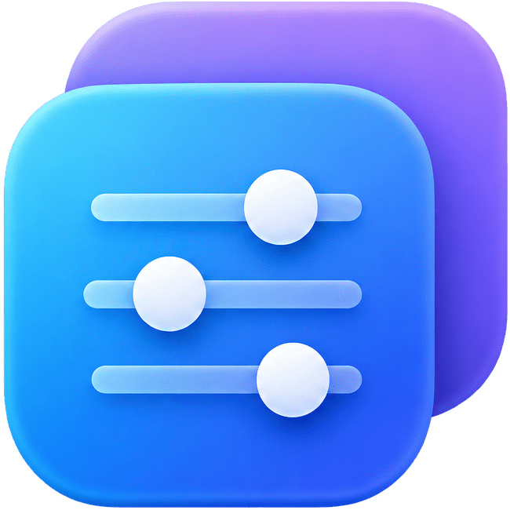
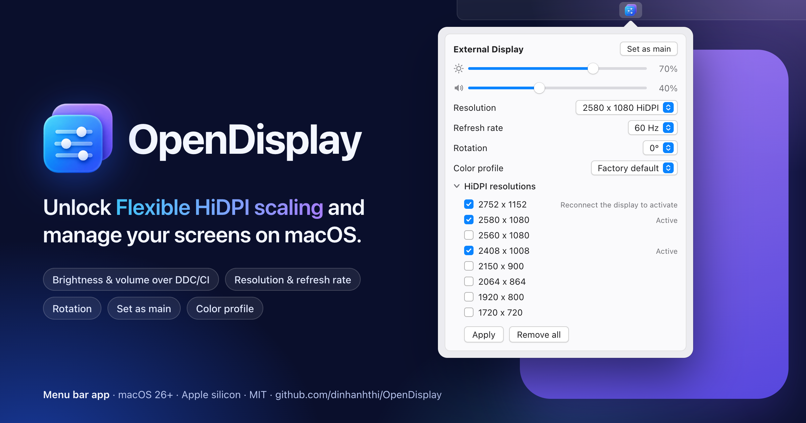

<div align="center">



# OpenDisplay

Unlock Flexible HiDPI scaling and manage your screens on macOS.

[](https://github.com/dinhanhthi/OpenDisplay/releases/latest)
[](LICENSE)

</div>

OpenDisplay is a small menu bar app. One click opens a popover with a card for each display, the main display first. There is no settings window and no Dock icon.



## Features

- HiDPI sizes for external displays: tick sizes from a preset list, then Apply.
- Resolution and refresh rate menus.
- Brightness: the built-in display, an external monitor over DDC/CI, or software dimming.
- Volume: an external monitor's speakers over DDC/CI, or the Mac's built-in output.
- Rotation, Set as main and Color profile.
- Launch at login, updates through Sparkle.

## Requirements

- macOS 26 or later, Apple silicon. Tested on macOS 27 only.
- An administrator password, only to add or remove HiDPI sizes.

## HiDPI sizes

Apply writes a display override file under `/Library/Displays/Contents/Resources/Overrides/` and turns on the WindowServer preference `DisplayResolutionEnabled`. Restart the Mac after the first Apply; later sizes only need a reconnect of the display.

These files stay when OpenDisplay is deleted, so use "Remove all" first. By hand:

```sh
ls -R /Library/Displays/Contents/Resources/Overrides
sudo rm /Library/Displays/Contents/Resources/Overrides/DisplayVendorID-<hex>/DisplayProductID-<hex>
# Only when no other override file is left:
sudo defaults delete /Library/Preferences/com.apple.windowserver DisplayResolutionEnabled
```

## Known limitations

- Only an external monitor's DDC/CI brightness and "Set as main" were tested on a device; the other controls, and Apply / Remove all, were not yet.
- HiDPI sizes must be smaller than the panel, some monitors accept less, and the override file is shared by every monitor of the same model.
- A monitor without DDC/CI, or two identical monitors, get software dimming and no volume slider. Software dimming does not change the backlight and stops when the app quits.
- OpenDisplay uses private APIs (`IOAVService` for DDC/CI, DisplayServices for built-in brightness, MonitorPanel for rotation) that a macOS update may break. A missing one hides or downgrades its control.

## Build

Needs Xcode 26 and [XcodeGen](https://github.com/yonaskolb/XcodeGen).

```sh
xcodegen generate
xcodebuild -project OpenDisplay.xcodeproj -scheme OpenDisplay -configuration Debug build
```

Without the Developer ID certificate, add `CODE_SIGN_IDENTITY=- CODE_SIGN_STYLE=Automatic DEVELOPMENT_TEAM=`. More in [CONTRIBUTING.md](CONTRIBUTING.md).

## License

MIT, see [LICENSE](LICENSE).
